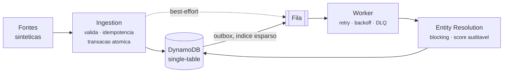

# Nexus Architecture

[](https://github.com/Buenno0/nexus-architecture/actions/workflows/ci.yml)

> Engineering distributed systems, one component at a time.

Plataforma experimental de engenharia de sistemas distribuidos. Demonstra como dados
provenientes de multiplas fontes podem ser recebidos, validados, normalizados,
processados de forma assincrona, correlacionados e monitorados.

**Todos os dados sao sinteticos.** Nenhum dado pessoal real e utilizado em qualquer etapa.



## Por onde comecar

Tres coisas, em ordem de interesse. Nenhuma delas e a lista de endpoints.

**1. Onde eu errei.** A parte mais util do projeto e a
[secao 6 do relatorio da Fase 7](docs/testing/phase-7-report.md): quatro erros meus de
medicao, dois deles com o sinal invertido — a mesma configuracao reportada como melhor
e como pior em corridas diferentes. O antidoto que funcionou foi repetir a medicao e
olhar a dispersao **antes** de olhar a diferenca. As corridas inconclusivas continuam
versionadas de proposito: apagar a evidencia tornaria a explicacao impossivel de
verificar.

**2. Por que cada mecanismo caro existe.** Outbox transacional, fila propria, trilha
durável e single-table sao decisoes desproporcionais ao volume medido, e cada uma tem um
[ADR](docs/adr/README.md) dizendo que problema resolve, o que foi recusado e o que
custa. O ADR-003 mantem no texto um argumento meu que estava errado, marcado como
errado.

**3. O que o sistema faz.** `./scripts/demo.sh` executa onze atos, da pilha subindo ate
um alerta acendendo e apagando — e **falha** quando o estado nao corresponde ao que
narra. Os [diagramas](docs/architecture/diagramas.md) cobrem o resto.

Limitacoes, agrupadas por causa e separando as ja vencidas das atuais:
[docs/testing/README.md](docs/testing/README.md). **Nenhuma capacidade nao implementada
e declarada em lugar nenhum deste repositorio** — quando um numero nao existe, esta
escrito que nao existe.

---

## Estado atual

| Modulo | Fase | Situacao |
|---|---|---|
| Nexus Ingestion | 1 | Implementado |
| Nexus Queue Engine | 2 | Implementado — fila, retry, DLQ, redrive |
| Cloud Infrastructure | 3 | Validado na AWS e **destruido** — custo real US$ 0,0001 |
| Nexus Control Center | 4 | Implementado — 5 telas, roda local |
| Nexus Entity Resolution | 5 | Implementado — perfeito contra o gabarito sintetico, o que diz menos do que parece[^1] |
| Nexus Observability | 6 | Implementado — trilha durável, serie persistida, alertas calculados |
| Performance Engineering | 7 | Medido localmente — gargalo identificado; nuvem pendente |
| Finalizacao | 8 | Diagramas, ADRs consolidados, demonstracao roteirizada, **CI verde no GitHub Actions** |

[^1]: Precisao 1,0000 e recall 1,0000 sobre 500 registros com variacoes que **eu mesmo
    gerei**: abreviacao, erro de digitacao, troca de provedor, campo omitido. O gabarito
    sabe quais pares sao verdadeiros porque o gerador os criou. Isso mede o resolvedor
    contra este conjunto, nao contra o mundo — dados reais trazem sujeira que o gerador
    nao imita, e um numero perfeito contra dados proprios e exatamente o tipo de
    resultado que merece desconfianca. O valor do exercicio esta no ciclo que ele
    permitiu: a primeira execucao deu recall 0,9823, a fila de revisao mostrou a causa
    concreta, e a correcao subiu o recall **sem introduzir nenhum falso positivo**. Ver
    [docs/testing/phase-5-report.md](docs/testing/phase-5-report.md).

A plataforma roda localmente em Docker. Em 07/11/2026 foi implantada na AWS e
validada ponta a ponta; em 09/11 foi **destruida**, deixando a conta limpa. Custo real
dos tres dias: **US$ 0,0001**.

A infraestrutura como codigo continua pronta para reaplicar — ver
[docs/runbook-deploy.md](docs/runbook-deploy.md) e [COSTS.md](COSTS.md).

---

## Requisitos

- Python 3.13 (gerenciado por [uv](https://docs.astral.sh/uv/))
- Docker + Docker Compose
- make

## Execucao

```bash
cp .env.example .env     # ajuste se necessario
make up                  # sobe DynamoDB Local + API
make test                # suite completa de testes
make lint                # ruff + mypy strict
```

A API fica disponivel em `http://localhost:8080`.
Documentacao interativa (OpenAPI) em `http://localhost:8080/docs`.

## Demonstracao em um comando

Para ver a plataforma inteira funcionando sem conhecer nenhum endpoint:

```bash
./scripts/demo.sh
```

Onze atos: sobe a pilha, ingere registros sinteticos, despacha o outbox, consome a fila,
mostra a jornada de um registro **atravessando dois processos**, exibe a resolucao de
identidade, injeta falha ate a DLQ, mostra o alerta acendendo, faz redrive e mostra o
alerta apagando.

Roteirizada, nao gravada. Um video envelhece em silencio; este script falha na etapa
exata que parar de funcionar. Use `--pausar` para acompanhar ato a ato e `--help` para
as demais opcoes.

## Endpoints (Fase 1)

| Metodo | Rota | Descricao |
|---|---|---|
| POST | `/v1/records/person` | Ingestao de registro de pessoa |
| POST | `/v1/records/organization` | Ingestao de registro de organizacao |
| GET | `/v1/records/{record_id}` | Consulta de registro |
| GET | `/v1/records` | Listagem paginada |
| GET | `/health` | Verificacao de saude |
| GET | `/metrics` | Metricas operacionais |

## Endpoints operacionais (Fase 2)

Nada processa sozinho: todo o modelo de custo depende de execucao sob demanda.

| Metodo | Rota | Descricao |
|---|---|---|
| POST | `/v1/ops/dispatch` | Publica eventos pendentes do outbox na fila |
| POST | `/v1/ops/process` | Consome um lote da fila |
| GET | `/v1/ops/queue` | Pendentes, em voo, DLQ e backlog do outbox |
| POST | `/v1/ops/redrive` | Devolve mensagens da DLQ para a fila |

```bash
make dispatch && make drain && make queue-stats
```

```bash
make fail-test RATE=0.5
```

## Control Center (Fase 4)

```bash
make up && make dashboard
```

Abre em `http://localhost:5173`. Cinco telas: Overview, API, Queue, Worker e Entity
Resolution.

**Todo numero declara de onde veio** — `persistido` vem do armazenamento, `processo`
zera no reinicio da API, `sessao` some ao recarregar a pagina. Metrica sem fonte real
aparece explicada, nunca inventada. Ver
[ADR-009](docs/adr/ADR-009-control-center.md).

```bash
make dashboard-check
```

## Entity Resolution (Fase 5)

| Metodo | Rota | Descricao |
|---|---|---|
| GET | `/v1/resolution/entities/{id}` | Entidade, vinculos e evidencia de cada fusao |
| GET | `/v1/resolution/reviews` | Pares em duvida aguardando decisao |
| POST | `/v1/resolution/reviews/{pair_id}` | `confirm` funde, `reject` registra a recusa |
| GET | `/v1/resolution/stats` | Contadores duraveis de resolucao |
| POST | `/v1/ops/reprocess` | Reenfileira o acervo sob a versao corrente |

Tres faixas de decisao: `MATCH` funde, `POSSIBLE_MATCH` vai para revisao humana e
**nunca funde sozinho**, `NO_MATCH` nao faz nada.

```bash
make reprocess && make drain && make resolution
```

```bash
make reviews
```

## AWS (Fase 3) — validada e destruida

```bash
make lambda
```

```bash
make tf-validate
```

Para aplicar, e para destruir depois:

```bash
cd infra/terraform && terraform apply
```

```bash
cd infra/terraform && terraform destroy
```

Procedimento completo, incluindo criacao de operador no Cognito e a tabela de
diagnostico com os defeitos que o deploy real revelou, em
[docs/runbook-deploy.md](docs/runbook-deploy.md).

### Medir a qualidade da resolucao

```bash
.venv/bin/python tools/generator.py --count 500 --duplicate-rate 0.15 --variant-rate 0.25 --post --seed 2026 --manifest gabarito.json
```

```bash
.venv/bin/python tools/evaluate_resolution.py --manifest gabarito.json
```

O gabarito liga cada registro a entidade verdadeira que o originou. Sem ele nao da para
afirmar que a resolucao funciona — apenas que ela roda.

### Header `Idempotency-Key` e obrigatorio nos POST

```bash
curl -X POST localhost:8080/v1/records/person \
  -H 'Content-Type: application/json' \
  -H "Idempotency-Key: $(uuidgen)" \
  -d '{
        "source": "demo",
        "full_name": "Maria Aparecida Souza",
        "email": "MARIA.SOUZA@Example.com ",
        "document": "123.456.789-09",
        "phone": "(11) 98765-4321"
      }'
```

| Situacao | Resposta |
|---|---|
| Header ausente | `400` |
| Corpo invalido | `422` |
| Mesma chave, mesmo corpo | `200` com a resposta armazenada |
| Mesma chave, corpo diferente | `409` |
| Mesmo conteudo ja observado | `200`, `status="duplicate"` |
| Observacao nova | `202`, `status="accepted"` |

Os tres conceitos de identidade (`idempotency_key`, `record_fingerprint` e entity
resolution) sao distintos por design — ver
[ADR-002](docs/adr/ADR-002-identidade-e-idempotencia.md).

## Observabilidade (Fase 6)

A trilha responde **"o que aconteceu com este registro"** atravessando os processos que
o tocaram. Ate a Fase 5 essa pergunta nao tinha resposta: o `correlation_id` era
propagado corretamente, mas o worker roda por `docker compose exec` e escrevia no
terminal de quem o chamou, nao no log do container.

| Rota | O que devolve |
|---|---|
| `GET /v1/observability/trail/{record_id}` | Jornada completa, em ordem, com o tempo entre marcos |
| `GET /v1/observability/series?window=60` | Serie persistida da profundidade da plataforma |
| `GET /v1/observability/alerts` | Condicoes ativas, derivadas do estado real |
| `POST /v1/ops/sample` | Forca uma amostra — usada pelo EventBridge Scheduler |

```bash
curl -s "localhost:8080/v1/observability/trail/$(curl -s 'localhost:8080/v1/records?limit=1' | python3 -c 'import json,sys;print(json.load(sys.stdin)["items"][0]["record_id"])')" | python3 -m json.tool
```

**O delta entre marcos e o que importa.** O total diz que o registro levou 5.487 ms; o
delta diz que 5.465 deles foram entre `published` e `consumed` — espera na fila, que
nenhuma otimizacao do processador recuperaria. `ProcessingResult.end_to_end_ms` grava
essa distincao em cada registro.

Toda escrita de observabilidade e **best-effort**: falha e registrada em log e engolida.
A trilha pode ter buracos e **nao serve como auditoria** — ver
[ADR-010](docs/adr/ADR-010-observabilidade.md).

---

## Desempenho (Fase 7)

Medido localmente. **Nao vale como previsao para a AWS** — ver
[docs/performance/metodologia.md](docs/performance/metodologia.md).

```bash
make campaign
```

**Teto por caminho**, cada um isolado, 200 usuarios:

| Caminho | Teto | O que faz |
|---|---|---|
| `replay` | 571,5 req/s | 1 `GetItem` e sai |
| `duplicata` | 247,8 req/s | + `Query` no `gsi_natural` |
| `novo` | 103,8 req/s | + transacao, trilha, publicacao |

O gargalo e o **trabalho de escrita**, nao o custo de atender: o mesmo FastAPI entrega
571 req/s quando nao precisa escrever. Dentro do caminho de escrita, o nucleo custa 9 ms
(56%), a trilha da Fase 6 custa 4 ms (25%) e a publicacao na fila 4 ms (25%).

O joelho da curva esta entre 10 e 50 usuarios simultaneos.

> **Nenhum numero comparativo aqui vem de uma corrida so.** Repetindo a mesma
> configuracao, a dispersao da vazao chega a 40% sob saturacao. Efeitos menores que isso
> nao sao observaveis com uma corrida — e a Fase 7 tirou tres conclusoes erradas antes
> de aprender isso. Estao registradas em
> [docs/testing/phase-7-report.md](docs/testing/phase-7-report.md).

---

## Modo demonstracao (Fase 9)

Preparado no codigo e no Terraform. **Nada foi aplicado na AWS** — a infraestrutura
continua destruida e o custo acumulado continua em US$ 0,0001.

```bash
NEXUS_DEMO_MODE=true docker compose up -d --wait
```

```bash
curl -s -X POST localhost:8080/v1/demo/seed -H 'content-type: application/json' -d '{"count":150}' | python3 -m json.tool
```

Com o modo ligado, a ingestao livre **deixa de existir**: `POST /v1/records/*` sai do
roteamento do API Gateway e responde `404` na propria aplicacao. A unica entrada e
`/v1/demo/seed`, que gera no servidor.

O motivo nao e economia de codigo. Numa URL publica, uma rota de ingestao aceita o
conteudo que qualquer pessoa queira gravar — e esse conteudo aparece no painel. **O
visitante escolhe quantos registros, nunca o que eles dizem.**

A credencial do convidado viaja no bundle JavaScript, porque uma SPA nao guarda
segredo. Entao a interface nao protege nada: os tetos valem no servidor, o acumulado
por escrita condicional atomica, e recusar custa uma operacao O(1) — um limite cuja
recusa custa caro e um amplificador de abuso. Ver [SECURITY.md](SECURITY.md) e
[COSTS.md](COSTS.md).

## Integracao continua (Fase 8)

`.github/workflows/ci.yml` roda, a cada push e pull request: `ruff`, `mypy --strict`, a
suite Python **inteira** (incluindo os testes de integracao, contra DynamoDB Local
subido pelo mesmo `docker-compose.yml` do desenvolvimento), tipos, lint, testes e build
do Control Center, e `terraform validate` com `-backend=false`.

O repositorio foi publicado em 12/11/2026 e a **primeira execucao passou nos quatro
jobs** ([run 43149734246](https://github.com/Buenno0/nexus-architecture/actions/runs/43149734246)): 1min31s no total, com a suite Python levando 72s e o
DynamoDB Local subindo em 12s.

Nenhum job recebe credencial da AWS e nenhum cria recurso.

Os mesmos comandos, a mao:

```bash
make lint && make test && make dashboard-check
```

## Dados sinteticos

```bash
make generate N=1000     # gera e envia 1000 registros sinteticos
```

## Documentacao

- [ARCHITECTURE.md](ARCHITECTURE.md) — desenho da plataforma
- [ROADMAP.md](ROADMAP.md) — fases de desenvolvimento
- [NEXT-PHASES.md](NEXT-PHASES.md) — planejamento das Fases 3 a 8
- [COSTS.md](COSTS.md) — estimativas e armadilhas de custo AWS
- [SECURITY.md](SECURITY.md) — postura de seguranca
- [CHANGELOG.md](CHANGELOG.md) — historico de mudancas
- [docs/architecture/diagramas.md](docs/architecture/diagramas.md) — diagramas da arquitetura
- [docs/architecture/access-patterns.md](docs/architecture/access-patterns.md) — modelagem DynamoDB
- [docs/testing/README.md](docs/testing/README.md) — **relatorio consolidado e limitacoes atuais**
- [docs/testing/phase-1-report.md](docs/testing/phase-1-report.md) — testes da Fase 1
- [docs/testing/phase-2-report.md](docs/testing/phase-2-report.md) — testes da Fase 2
- [docs/testing/phase-4-report.md](docs/testing/phase-4-report.md) — testes da Fase 4
- [docs/testing/phase-5-report.md](docs/testing/phase-5-report.md) — testes e qualidade da Fase 5
- [docs/testing/phase-6-report.md](docs/testing/phase-6-report.md) — testes da Fase 6
- [docs/testing/phase-7-report.md](docs/testing/phase-7-report.md) — medicoes da Fase 7
- [docs/testing/phase-8-report.md](docs/testing/phase-8-report.md) — verificacao da Fase 8
- [docs/performance/metodologia.md](docs/performance/metodologia.md) — como as medicoes foram feitas
- [docs/performance/](docs/performance/) — medicoes
- [docs/adr/README.md](docs/adr/README.md) — **indice dos ADRs, com as decisoes superadas marcadas**
  - [ADR-001](docs/adr/ADR-001-dynamodb-local.md) — DynamoDB Local em vez de PostgreSQL
  - [ADR-002](docs/adr/ADR-002-identidade-e-idempotencia.md) — Operacao, conteudo e entidade
  - [ADR-003](docs/adr/ADR-003-transactional-outbox.md) — Transactional outbox com GSI esparso
  - [ADR-004](docs/adr/ADR-004-fila-local-sqlite.md) — Fila local sobre SQLite
  - [ADR-005](docs/adr/ADR-005-idempotencia-no-consumo.md) — Idempotencia no consumo
  - [ADR-006](docs/adr/ADR-006-entity-resolution.md) — Blocking, pontuacao e clusterizacao
  - [ADR-007](docs/adr/ADR-007-versionamento-do-processador.md) — Versionamento do processador
  - [ADR-008](docs/adr/ADR-008-arquitetura-serverless.md) — Arquitetura serverless na AWS
  - [ADR-009](docs/adr/ADR-009-control-center.md) — Todo numero declara de onde veio
  - [ADR-010](docs/adr/ADR-010-observabilidade.md) — Trilha durável, best-effort, por registro
- [docs/runbook-deploy.md](docs/runbook-deploy.md) — procedimento de deploy e destruicao
- [docs/runbook-demo.md](docs/runbook-demo.md) — procedimento da demonstracao publica

## Limitacoes conhecidas

- **Nao ha autenticacao.** A API e aberta no ambiente local. Requisito da Fase 3.
- **A fila so pode ser acessada de dentro do container** — SQLite em WAL nao
  atravessa a fronteira host/VM no macOS. Ver [ADR-004](docs/adr/ADR-004-fila-local-sqlite.md).
- **Os endpoints `/v1/ops/*` nao tem autenticacao.** Fase 3.
- **As metricas de qualidade da resolucao valem para dados sinteticos.** Dados reais
  trazem sujeira que o gerador nao imita.
- **Pesos e limiares de correspondencia sao parametros calibrados**, nao verdades.
- **Nao ha operacao de desfazer fusao.** A evidencia permite localizar a aresta
  culpada, mas reverte-la e manual.
- **O comportamento sob carga na AWS nao foi medido.** A Fase 7 mediu localmente; a
  nuvem exige reaplicar a infraestrutura, e a conta tem cota de 10 execucoes
  concorrentes, entao qualquer vazao medida la seria a cota e nao a arquitetura.
- **Cold start nao foi quantificado** — depende do item acima.
- **Nenhum dominio proprio configurado.**
- **Parte do historico do dashboard ainda vive na aba.** A profundidade da plataforma
  passou a vir da serie persistida na Fase 6, mas as series de taxa das telas API e
  Worker continuam acumuladas no navegador e zeram ao recarregar. O rotulo `sessao`
  marca quais sao.
- **A trilha nao e auditoria.** Best-effort por decisao: pode ter buracos. A garantia
  continua em `StoredRecord` e `ProcessingResult`, que sao transacionais.
- **A serie so avanca quando alguem observa.** Nao ha processo amostrando em laco. Com
  o painel fechado, a janela tem buracos — e a interface diz quantos.
- **A amostragem pelo EventBridge Scheduler nao foi validada na nuvem**, que esta
  destruida. A rota existe e e testada localmente.
- **O dashboard nao foi publicado na Vercel**; roda local contra a API em Docker.
- **Deduplicacao por conteudo e best-effort sob concorrencia** — o indice consultado e
  eventualmente consistente. A resolucao autoritativa de identidade e da Fase 5.
- **Metricas sao do processo**: zeram no reinicio e nao agregam entre replicas.
- Nenhum recurso de nuvem foi provisionado; nenhuma medicao local vale como previsao
  de desempenho ou custo na AWS.


Lista completa, agrupada por causa e com as limitacoes ja vencidas separadas das que
continuam valendo: [docs/testing/README.md](docs/testing/README.md).

Este projeto e experimental e **nao** deve ser tratado como sistema de producao.
