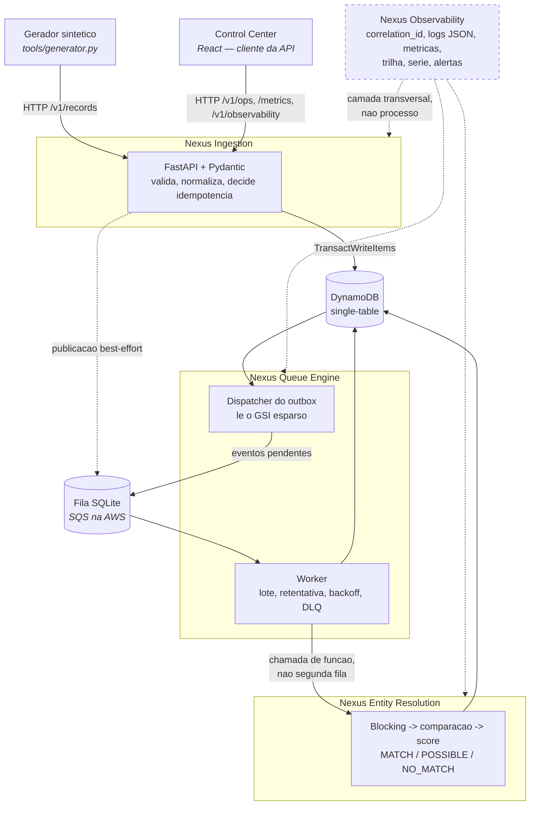
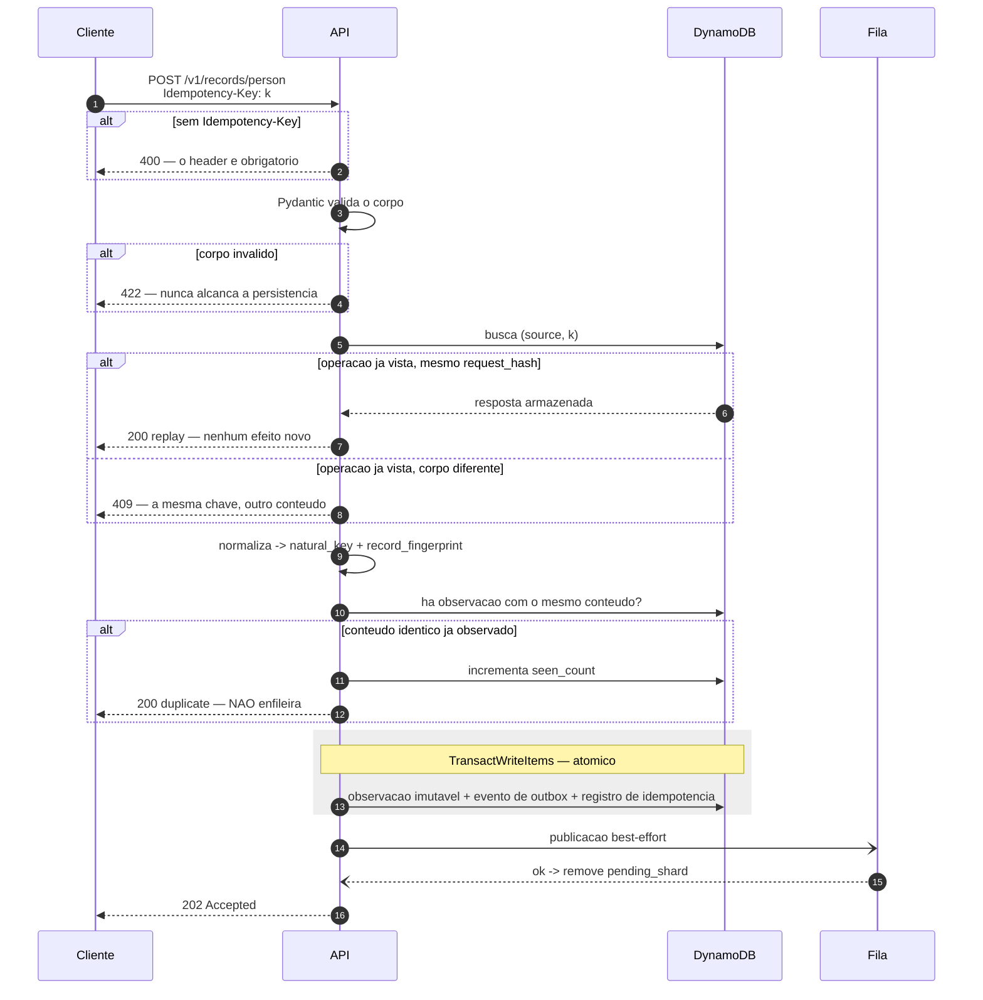
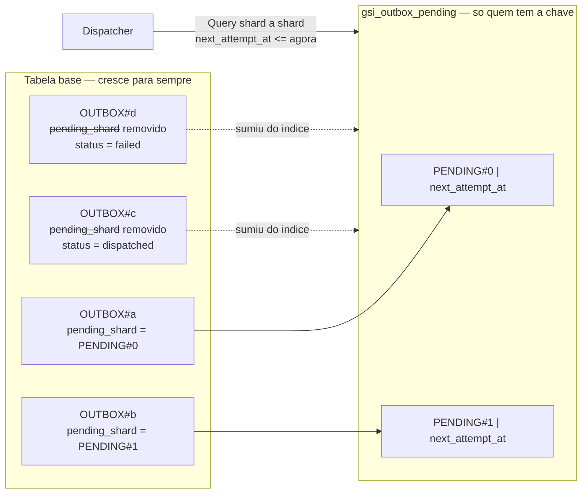
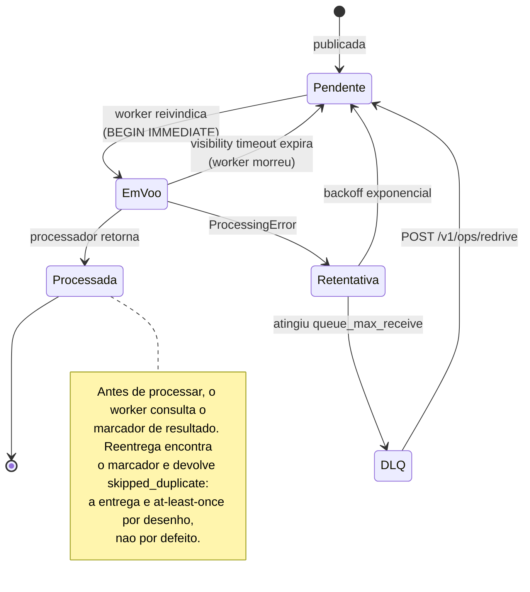
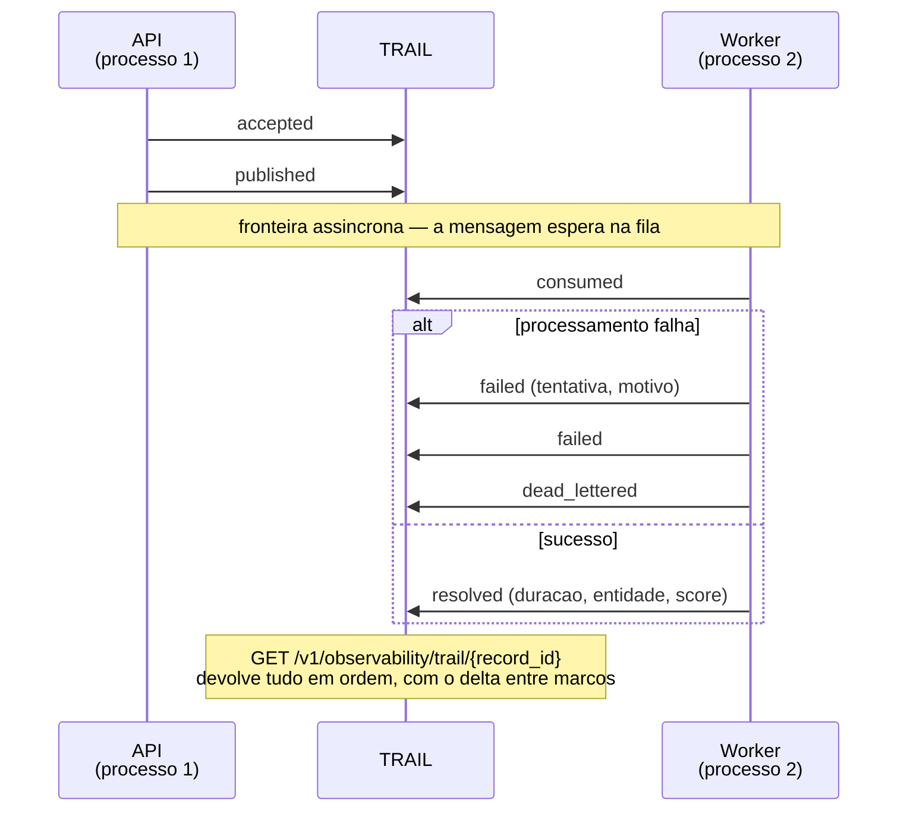
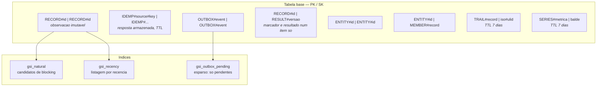
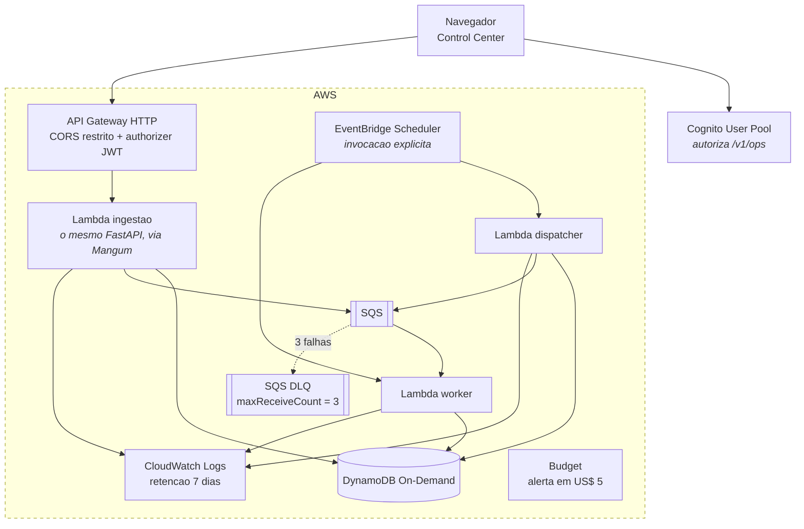

# Diagramas — Nexus Architecture

Diagramas em [Mermaid](https://mermaid.js.org/), nao em imagem. A razao e de revisao:
um PNG muda e o diff mostra "binario alterado"; um diagrama em texto mostra qual seta
mudou. O GitHub renderiza Mermaid nativamente, entao o custo de legibilidade e zero.

Cada diagrama abaixo descreve **o que esta implementado e testado**. O da infraestrutura
AWS e a excecao explicita, e diz isso no proprio titulo.

---

## 1. Modulos e o que atravessa cada fronteira

**Entity Resolution e chamada de funcao, nao uma segunda fila.** Outra fila somaria
latencia e um ponto de falha sem resolver problema existente. Promove-la depende de
necessidade concreta de escalar separadamente, que nao existe.

**Observability nao e um processo.** E a razao de ela aparecer tracejada: nao ha
servico de observabilidade para subir ou cair.

---

## 2. Ingestao: os dois desvios antes da transacao

**Os dois desvios sao perguntas diferentes.** O passo da chave de idempotencia pergunta
*"esta operacao ja foi executada?"*; o do fingerprint pergunta *"este conteudo ja foi
observado?"*. Um cliente que repete a chamada com chave nova e conteudo igual passa pelo
primeiro e para no segundo — e e por isso que `seen_count` existe.

---

## 3. Outbox: por que o indice e proporcional ao backlog

Publicar com sucesso **remove o atributo**, e o item desaparece do indice — indices
esparsos contem apenas itens que possuem a chave. A leitura e O(pendentes), nao O(tabela).
Um `Scan` com filtro leria tudo e cobraria por tudo.

O `shard` existe para que a escrita do indice nao caia toda numa particao: com `PK`
constante, todo evento pendente disputaria a mesma. Como efeito secundario, permite
despachar em paralelo.

---

## 4. Consumo: o ciclo de vida de uma mensagem

`EmVoo --> Pendente` nao e caminho de erro. **A mensagem volta sozinha quando o
consumidor morre sem confirmar** — e essa e a propriedade que torna o worker descartavel.

O recibo identifica *uma entrega de uma mensagem*, nunca o lote. Com recibo por lote,
confirmar a primeira apagaria as demais.

---

## 5. A trilha atravessa processos

**E a unica estrutura do projeto que um unico processo nao consegue produzir.** Antes
dela, `accepted` ficava no log do container da API e `consumed` no terminal de quem
executou o worker — as duas metades da mesma jornada em lugares que nunca se encontram.

O delta entre marcos e o que diagnostica: um total de oito segundos com sete deles entre
`published` e `consumed` e espera na fila, e nenhuma otimizacao do processador os
recupera.

---

## 6. Modelo single-table

Marcador de processamento e resultado sao **um unico item** (ADR-005): gravados
separadamente, um crash entre as duas escritas deixaria o registro marcado como
processado sem resultado nenhum.

Trilha e serie usam a tabela base e **nenhum indice novo** — foi o criterio que decidiu
chavear a trilha por `record_id` em vez de `correlation_id`.

---

## 7. Infraestrutura AWS — construida, validada e **destruida**

> Este diagrama descreve o que o Terraform em `infra/terraform/` cria quando aplicado.
> **Nada disso esta no ar hoje.** A infraestrutura foi aplicada, verificada e destruida
> na Fase 3; o custo acumulado do projeto e US$ 0,00. Ver
> [COSTS.md](../../COSTS.md) e [docs/testing/phase-3-report.md](../testing/phase-3-report.md).

**Nao ha event source mapping de SQS para Lambda.** Ele faz long-polling continuo, o que
desfaz exatamente a execucao sob demanda que a plataforma existe para demonstrar. O
preco dessa escolha esta registrado: sem consumidor residente, uma mensagem que falha
espera ate alguem invocar o worker.

**Nao ha VPC privada.** O isolamento e por IAM. Um NAT Gateway custaria cerca de
US$ 32/mes parado, mais que todo o resto da plataforma somado.

---

## Como manter

Mermaid vive dentro do Markdown e renderiza no GitHub sem passo de build. Para conferir
antes de versionar: [mermaid.live](https://mermaid.live).

Diagrama que descreve algo nao implementado precisa dizer isso **no titulo**, como o da
secao 7 — nao em nota de rodape, que ninguem le depois de ter olhado a figura.
